# Projects and dependencies analysis

This document provides a comprehensive overview of the projects and their dependencies in the context of upgrading to .NETCoreApp,Version=v10.0.

## Table of Contents

- [Executive Summary](#executive-Summary)
  - [Highlevel Metrics](#highlevel-metrics)
  - [Projects Compatibility](#projects-compatibility)
  - [Package Compatibility](#package-compatibility)
  - [API Compatibility](#api-compatibility)
  - [Binding Redirect Configuration](#binding-redirect-configuration)
- [Aggregate NuGet packages details](#aggregate-nuget-packages-details)
- [Top API Migration Challenges](#top-api-migration-challenges)
  - [Technologies and Features](#technologies-and-features)
  - [Most Frequent API Issues](#most-frequent-api-issues)
- [Projects Relationship Graph](#projects-relationship-graph)
- [Project Details](#project-details)

  - [RiverBooks.AppHost\RiverBooks.AppHost.csproj](#riverbooksapphostriverbooksapphostcsproj)
  - [RiverBooks.Books.Contracts\RiverBooks.Books.Contracts.csproj](#riverbooksbookscontractsriverbooksbookscontractscsproj)
  - [RiverBooks.Books.Tests\RiverBooks.Books.Tests.csproj](#riverbooksbookstestsriverbooksbookstestscsproj)
  - [RiverBooks.Books\RiverBooks.Books.csproj](#riverbooksbooksriverbooksbookscsproj)
  - [RiverBooks.EmailSending.Contracts\RiverBooks.EmailSending.Contracts.csproj](#riverbooksemailsendingcontractsriverbooksemailsendingcontractscsproj)
  - [RiverBooks.EmailSending\RiverBooks.EmailSending.csproj](#riverbooksemailsendingriverbooksemailsendingcsproj)
  - [RiverBooks.OrderProcessing.Contracts\RiverBooks.OrderProcessing.Contracts.csproj](#riverbooksorderprocessingcontractsriverbooksorderprocessingcontractscsproj)
  - [RiverBooks.OrderProcessing\RiverBooks.OrderProcessing.csproj](#riverbooksorderprocessingriverbooksorderprocessingcsproj)
  - [RiverBooks.OrderProcessingTests\RiverBooks.OrderProcessingTests.csproj](#riverbooksorderprocessingtestsriverbooksorderprocessingtestscsproj)
  - [RiverBooks.Reporting\RiverBooks.Reporting.csproj](#riverbooksreportingriverbooksreportingcsproj)
  - [RiverBooks.ServiceDefaults\RiverBooks.ServiceDefaults.csproj](#riverbooksservicedefaultsriverbooksservicedefaultscsproj)
  - [RiverBooks.SharedKernel.Tests\RiverBooks.SharedKernel.Tests.csproj](#riverbookssharedkerneltestsriverbookssharedkerneltestscsproj)
  - [RiverBooks.SharedKernel\RiverBooks.SharedKernel.csproj](#riverbookssharedkernelriverbookssharedkernelcsproj)
  - [RiverBooks.Users.Contracts\RiverBooks.Users.Contracts.csproj](#riverbooksuserscontractsriverbooksuserscontractscsproj)
  - [RiverBooks.Users\RiverBooks.Users.csproj](#riverbooksusersriverbooksuserscsproj)
  - [RiverBooks.Web\RiverBooks.Web.csproj](#riverbookswebriverbookswebcsproj)

## Executive Summary

### Highlevel Metrics

| Metric | Count | Status |
| :--- | :---: | :--- |
| Total Projects | 16 | 0 require upgrade |
| Total NuGet Packages | 48 | All compatible |
| Total Code Files | 200 |  |
| Total Code Files with Incidents | 0 |  |
| Total Lines of Code | 7947 |  |
| Total Number of Issues | 0 |  |
| Estimated LOC to modify | 0+ | at least 0,0% of codebase |

### Projects Compatibility

| Project | Target Framework | Difficulty | Package Issues | API Issues | Binding Issues | Est. LOC Impact | Description |
| :--- | :---: | :---: | :---: | :---: | :---: | :---: | :--- |
| [RiverBooks.AppHost\RiverBooks.AppHost.csproj](#riverbooksapphostriverbooksapphostcsproj) | net11.0 | ✅ None | 0 | 0 | 0 |  | DotNetCoreApp, Sdk Style = True |
| [RiverBooks.Books.Contracts\RiverBooks.Books.Contracts.csproj](#riverbooksbookscontractsriverbooksbookscontractscsproj) | net11.0 | ✅ None | 0 | 0 | 0 |  | ClassLibrary, Sdk Style = True |
| [RiverBooks.Books.Tests\RiverBooks.Books.Tests.csproj](#riverbooksbookstestsriverbooksbookstestscsproj) | net11.0 | ✅ None | 0 | 0 | 0 |  | DotNetCoreApp, Sdk Style = True |
| [RiverBooks.Books\RiverBooks.Books.csproj](#riverbooksbooksriverbooksbookscsproj) | net11.0 | ✅ None | 0 | 0 | 0 |  | ClassLibrary, Sdk Style = True |
| [RiverBooks.EmailSending.Contracts\RiverBooks.EmailSending.Contracts.csproj](#riverbooksemailsendingcontractsriverbooksemailsendingcontractscsproj) | net11.0 | ✅ None | 0 | 0 | 0 |  | ClassLibrary, Sdk Style = True |
| [RiverBooks.EmailSending\RiverBooks.EmailSending.csproj](#riverbooksemailsendingriverbooksemailsendingcsproj) | net11.0 | ✅ None | 0 | 0 | 0 |  | ClassLibrary, Sdk Style = True |
| [RiverBooks.OrderProcessing.Contracts\RiverBooks.OrderProcessing.Contracts.csproj](#riverbooksorderprocessingcontractsriverbooksorderprocessingcontractscsproj) | net11.0 | ✅ None | 0 | 0 | 0 |  | ClassLibrary, Sdk Style = True |
| [RiverBooks.OrderProcessing\RiverBooks.OrderProcessing.csproj](#riverbooksorderprocessingriverbooksorderprocessingcsproj) | net11.0 | ✅ None | 0 | 0 | 0 |  | ClassLibrary, Sdk Style = True |
| [RiverBooks.OrderProcessingTests\RiverBooks.OrderProcessingTests.csproj](#riverbooksorderprocessingtestsriverbooksorderprocessingtestscsproj) | net11.0 | ✅ None | 0 | 0 | 0 |  | DotNetCoreApp, Sdk Style = True |
| [RiverBooks.Reporting\RiverBooks.Reporting.csproj](#riverbooksreportingriverbooksreportingcsproj) | net11.0 | ✅ None | 0 | 0 | 0 |  | ClassLibrary, Sdk Style = True |
| [RiverBooks.ServiceDefaults\RiverBooks.ServiceDefaults.csproj](#riverbooksservicedefaultsriverbooksservicedefaultscsproj) | net11.0 | ✅ None | 0 | 0 | 0 |  | ClassLibrary, Sdk Style = True |
| [RiverBooks.SharedKernel.Tests\RiverBooks.SharedKernel.Tests.csproj](#riverbookssharedkerneltestsriverbookssharedkerneltestscsproj) | net11.0 | ✅ None | 0 | 0 | 0 |  | DotNetCoreApp, Sdk Style = True |
| [RiverBooks.SharedKernel\RiverBooks.SharedKernel.csproj](#riverbookssharedkernelriverbookssharedkernelcsproj) | net11.0 | ✅ None | 0 | 0 | 0 |  | ClassLibrary, Sdk Style = True |
| [RiverBooks.Users.Contracts\RiverBooks.Users.Contracts.csproj](#riverbooksuserscontractsriverbooksuserscontractscsproj) | net11.0 | ✅ None | 0 | 0 | 0 |  | ClassLibrary, Sdk Style = True |
| [RiverBooks.Users\RiverBooks.Users.csproj](#riverbooksusersriverbooksuserscsproj) | net11.0 | ✅ None | 0 | 0 | 0 |  | ClassLibrary, Sdk Style = True |
| [RiverBooks.Web\RiverBooks.Web.csproj](#riverbookswebriverbookswebcsproj) | net11.0 | ✅ None | 0 | 0 | 0 |  | AspNetCore, Sdk Style = True |

### Package Compatibility

| Status | Count | Percentage |
| :--- | :---: | :---: |
| ✅ Compatible | 48 | 100,0% |
| ⚠️ Incompatible | 0 | 0,0% |
| 🔄 Upgrade Recommended | 0 | 0,0% |
| ***Total NuGet Packages*** | ***48*** | ***100%*** |

### API Compatibility

| Category | Count | Impact |
| :--- | :---: | :--- |
| 🔴 Binary Incompatible | 0 | High - Require code changes |
| 🟡 Source Incompatible | 0 | Medium - Needs re-compilation and potential conflicting API error fixing |
| 🔵 Behavioral change | 0 | Low - Behavioral changes that may require testing at runtime |
| ✅ Compatible | 0 |  |
| ***Total APIs Analyzed*** | ***0*** |  |

## Aggregate NuGet packages details

| Package | Current Version | Suggested Version | Projects | Description |
| :--- | :---: | :---: | :--- | :--- |
| Ardalis.GuardClauses | 5.0.0 |  | [RiverBooks.Books.csproj](#riverbooksbooksriverbooksbookscsproj) [RiverBooks.OrderProcessing.csproj](#riverbooksorderprocessingriverbooksorderprocessingcsproj) [RiverBooks.SharedKernel.csproj](#riverbookssharedkernelriverbookssharedkernelcsproj) [RiverBooks.Users.csproj](#riverbooksusersriverbooksuserscsproj) | ✅Compatible |
| Ardalis.Result | 10.1.0 |  | [RiverBooks.Books.Contracts.csproj](#riverbooksbookscontractsriverbooksbookscontractscsproj) [RiverBooks.Books.csproj](#riverbooksbooksriverbooksbookscsproj) [RiverBooks.EmailSending.Contracts.csproj](#riverbooksemailsendingcontractsriverbooksemailsendingcontractscsproj) [RiverBooks.EmailSending.csproj](#riverbooksemailsendingriverbooksemailsendingcsproj) [RiverBooks.OrderProcessing.Contracts.csproj](#riverbooksorderprocessingcontractsriverbooksorderprocessingcontractscsproj) [RiverBooks.OrderProcessing.csproj](#riverbooksorderprocessingriverbooksorderprocessingcsproj) [RiverBooks.Reporting.csproj](#riverbooksreportingriverbooksreportingcsproj) [RiverBooks.SharedKernel.csproj](#riverbookssharedkernelriverbookssharedkernelcsproj) [RiverBooks.Users.Contracts.csproj](#riverbooksuserscontractsriverbooksuserscontractscsproj) [RiverBooks.Users.csproj](#riverbooksusersriverbooksuserscsproj) | ✅Compatible |
| Ardalis.Result.AspNetCore | 10.1.0 |  | [RiverBooks.Users.csproj](#riverbooksusersriverbooksuserscsproj) | ✅Compatible |
| Ardalis.Result.FluentValidation | 10.1.0 |  | [RiverBooks.SharedKernel.csproj](#riverbookssharedkernelriverbookssharedkernelcsproj) | ✅Compatible |
| Ardalis.Specification | 9.3.1 |  | [RiverBooks.OrderProcessing.csproj](#riverbooksorderprocessingriverbooksorderprocessingcsproj) | ✅Compatible |
| Ardalis.Specification.EntityFrameworkCore | 9.3.1 |  | [RiverBooks.OrderProcessing.csproj](#riverbooksorderprocessingriverbooksorderprocessingcsproj) | ✅Compatible |
| Aspire.Hosting.SqlServer | 13.6.5 |  | [RiverBooks.AppHost.csproj](#riverbooksapphostriverbooksapphostcsproj) | ✅Compatible |
| coverlet.collector | 10.1.0 |  | [RiverBooks.Books.Tests.csproj](#riverbooksbookstestsriverbooksbookstestscsproj) [RiverBooks.OrderProcessingTests.csproj](#riverbooksorderprocessingtestsriverbooksorderprocessingtestscsproj) [RiverBooks.SharedKernel.Tests.csproj](#riverbookssharedkerneltestsriverbookssharedkerneltestscsproj) | ✅Compatible |
| Dapper | 2.1.89 |  | [RiverBooks.Reporting.csproj](#riverbooksreportingriverbooksreportingcsproj) | ✅Compatible |
| FastEndpoints | 9.0.0 |  | [RiverBooks.Books.csproj](#riverbooksbooksriverbooksbookscsproj) [RiverBooks.EmailSending.csproj](#riverbooksemailsendingriverbooksemailsendingcsproj) [RiverBooks.OrderProcessing.csproj](#riverbooksorderprocessingriverbooksorderprocessingcsproj) [RiverBooks.Reporting.csproj](#riverbooksreportingriverbooksreportingcsproj) [RiverBooks.Users.csproj](#riverbooksusersriverbooksuserscsproj) [RiverBooks.Web.csproj](#riverbookswebriverbookswebcsproj) | ✅Compatible |
| FastEndpoints.Security | 9.0.0 |  | [RiverBooks.EmailSending.csproj](#riverbooksemailsendingriverbooksemailsendingcsproj) [RiverBooks.OrderProcessing.csproj](#riverbooksorderprocessingriverbooksorderprocessingcsproj) [RiverBooks.Reporting.csproj](#riverbooksreportingriverbooksreportingcsproj) [RiverBooks.Users.csproj](#riverbooksusersriverbooksuserscsproj) [RiverBooks.Web.csproj](#riverbookswebriverbookswebcsproj) | ✅Compatible |
| FastEndpoints.Swagger | 9.0.0 |  | [RiverBooks.Web.csproj](#riverbookswebriverbookswebcsproj) | ✅Compatible |
| FastEndpoints.Testing | 9.0.0 |  | [RiverBooks.Books.Tests.csproj](#riverbooksbookstestsriverbooksbookstestscsproj) | ✅Compatible |
| FluentValidation | 12.2.0 |  | [RiverBooks.SharedKernel.csproj](#riverbookssharedkernelriverbookssharedkernelcsproj) | ✅Compatible |
| MailKit | 5.0.0 |  | [RiverBooks.EmailSending.csproj](#riverbooksemailsendingriverbooksemailsendingcsproj) | ✅Compatible |
| Mediator.Abstractions | 3.0.2 |  | [RiverBooks.Books.Contracts.csproj](#riverbooksbookscontractsriverbooksbookscontractscsproj) [RiverBooks.Books.csproj](#riverbooksbooksriverbooksbookscsproj) [RiverBooks.EmailSending.Contracts.csproj](#riverbooksemailsendingcontractsriverbooksemailsendingcontractscsproj) [RiverBooks.EmailSending.csproj](#riverbooksemailsendingriverbooksemailsendingcsproj) [RiverBooks.OrderProcessing.Contracts.csproj](#riverbooksorderprocessingcontractsriverbooksorderprocessingcontractscsproj) [RiverBooks.OrderProcessing.csproj](#riverbooksorderprocessingriverbooksorderprocessingcsproj) [RiverBooks.Reporting.csproj](#riverbooksreportingriverbooksreportingcsproj) [RiverBooks.SharedKernel.csproj](#riverbookssharedkernelriverbookssharedkernelcsproj) [RiverBooks.Users.Contracts.csproj](#riverbooksuserscontractsriverbooksuserscontractscsproj) [RiverBooks.Users.csproj](#riverbooksusersriverbooksuserscsproj) [RiverBooks.Web.csproj](#riverbookswebriverbookswebcsproj) | ✅Compatible |
| Mediator.SourceGenerator | 3.0.2 |  | [RiverBooks.Web.csproj](#riverbookswebriverbookswebcsproj) | ✅Compatible |
| MessagePack | 3.1.12 |  | [RiverBooks.AppHost.csproj](#riverbooksapphostriverbooksapphostcsproj) | ✅Compatible |
| Microsoft.AspNetCore.Authentication.JwtBearer | 11.0.0 |  | [RiverBooks.Books.csproj](#riverbooksbooksriverbooksbookscsproj) [RiverBooks.Users.csproj](#riverbooksusersriverbooksuserscsproj) | ✅Compatible |
| Microsoft.AspNetCore.Identity.EntityFrameworkCore | 11.0.0 |  | [RiverBooks.Users.csproj](#riverbooksusersriverbooksuserscsproj) | ✅Compatible |
| Microsoft.AspNetCore.OpenApi | 10.0.0 |  | [RiverBooks.Web.csproj](#riverbookswebriverbookswebcsproj) | ✅Compatible |
| Microsoft.Data.SqlClient | 7.1.1 |  | [RiverBooks.Reporting.csproj](#riverbooksreportingriverbooksreportingcsproj) | ✅Compatible |
| Microsoft.EntityFrameworkCore | 11.0.0 |  | [RiverBooks.Books.csproj](#riverbooksbooksriverbooksbookscsproj) [RiverBooks.OrderProcessing.csproj](#riverbooksorderprocessingriverbooksorderprocessingcsproj) [RiverBooks.Users.csproj](#riverbooksusersriverbooksuserscsproj) | ✅Compatible |
| Microsoft.EntityFrameworkCore.Design | 10.0.0 |  | [RiverBooks.Web.csproj](#riverbookswebriverbookswebcsproj) | ✅Compatible |
| Microsoft.EntityFrameworkCore.Design | 11.0.0 |  | [RiverBooks.Books.csproj](#riverbooksbooksriverbooksbookscsproj) | ✅Compatible |
| Microsoft.EntityFrameworkCore.SqlServer | 11.0.0 |  | [RiverBooks.Books.csproj](#riverbooksbooksriverbooksbookscsproj) [RiverBooks.OrderProcessing.csproj](#riverbooksorderprocessingriverbooksorderprocessingcsproj) [RiverBooks.Users.csproj](#riverbooksusersriverbooksuserscsproj) | ✅Compatible |
| Microsoft.Extensions.Http.Resilience | 11.0.0 |  | [RiverBooks.ServiceDefaults.csproj](#riverbooksservicedefaultsriverbooksservicedefaultscsproj) | ✅Compatible |
| Microsoft.Extensions.ServiceDiscovery | 11.0.0 |  | [RiverBooks.ServiceDefaults.csproj](#riverbooksservicedefaultsriverbooksservicedefaultscsproj) | ✅Compatible |
| Microsoft.NET.Test.Sdk | 18.12.0 |  | [RiverBooks.Books.Tests.csproj](#riverbooksbookstestsriverbooksbookstestscsproj) [RiverBooks.OrderProcessingTests.csproj](#riverbooksorderprocessingtestsriverbooksorderprocessingtestscsproj) [RiverBooks.SharedKernel.Tests.csproj](#riverbookssharedkerneltestsriverbookssharedkerneltestscsproj) | ✅Compatible |
| MongoDB.Driver | 3.13.0 |  | [RiverBooks.EmailSending.csproj](#riverbooksemailsendingriverbooksemailsendingcsproj) | ✅Compatible |
| NsDepCop | 3.3.0 |  | [RiverBooks.Books.csproj](#riverbooksbooksriverbooksbookscsproj) [RiverBooks.EmailSending.csproj](#riverbooksemailsendingriverbooksemailsendingcsproj) [RiverBooks.OrderProcessing.csproj](#riverbooksorderprocessingriverbooksorderprocessingcsproj) [RiverBooks.Reporting.csproj](#riverbooksreportingriverbooksreportingcsproj) [RiverBooks.Users.csproj](#riverbooksusersriverbooksuserscsproj) [RiverBooks.Web.csproj](#riverbookswebriverbookswebcsproj) | ✅Compatible |
| NSubstitute | 6.2.0 |  | [RiverBooks.OrderProcessingTests.csproj](#riverbooksorderprocessingtestsriverbooksorderprocessingtestscsproj) [RiverBooks.SharedKernel.Tests.csproj](#riverbookssharedkerneltestsriverbookssharedkerneltestscsproj) | ✅Compatible |
| OpenTelemetry.Exporter.OpenTelemetryProtocol | 1.21.0 |  | [RiverBooks.ServiceDefaults.csproj](#riverbooksservicedefaultsriverbooksservicedefaultscsproj) | ✅Compatible |
| OpenTelemetry.Extensions.Hosting | 1.21.0 |  | [RiverBooks.ServiceDefaults.csproj](#riverbooksservicedefaultsriverbooksservicedefaultscsproj) [RiverBooks.SharedKernel.csproj](#riverbookssharedkernelriverbookssharedkernelcsproj) | ✅Compatible |
| OpenTelemetry.Instrumentation.AspNetCore | 1.21.0 |  | [RiverBooks.ServiceDefaults.csproj](#riverbooksservicedefaultsriverbooksservicedefaultscsproj) | ✅Compatible |
| OpenTelemetry.Instrumentation.Http | 1.21.0 |  | [RiverBooks.ServiceDefaults.csproj](#riverbooksservicedefaultsriverbooksservicedefaultscsproj) | ✅Compatible |
| OpenTelemetry.Instrumentation.Runtime | 1.21.0 |  | [RiverBooks.ServiceDefaults.csproj](#riverbooksservicedefaultsriverbooksservicedefaultscsproj) | ✅Compatible |
| Serilog.AspNetCore | 10.0.0 |  | [RiverBooks.Books.csproj](#riverbooksbooksriverbooksbookscsproj) [RiverBooks.EmailSending.csproj](#riverbooksemailsendingriverbooksemailsendingcsproj) [RiverBooks.OrderProcessing.csproj](#riverbooksorderprocessingriverbooksorderprocessingcsproj) [RiverBooks.Reporting.csproj](#riverbooksreportingriverbooksreportingcsproj) [RiverBooks.Users.csproj](#riverbooksusersriverbooksuserscsproj) [RiverBooks.Web.csproj](#riverbookswebriverbookswebcsproj) | ✅Compatible |
| SharpCompress | 1.0.0 |  | [RiverBooks.EmailSending.csproj](#riverbooksemailsendingriverbooksemailsendingcsproj) | ✅Compatible |
| Shouldly | 4.3.0 |  | [RiverBooks.Books.Tests.csproj](#riverbooksbookstestsriverbooksbookstestscsproj) [RiverBooks.OrderProcessingTests.csproj](#riverbooksorderprocessingtestsriverbooksorderprocessingtestscsproj) [RiverBooks.SharedKernel.Tests.csproj](#riverbookssharedkerneltestsriverbookssharedkerneltestscsproj) | ✅Compatible |
| SSH.NET | 2026.0.0 |  | [RiverBooks.Books.Tests.csproj](#riverbooksbookstestsriverbooksbookstestscsproj) | ✅Compatible |
| StackExchange.Redis | 3.4.35 |  | [RiverBooks.OrderProcessing.csproj](#riverbooksorderprocessingriverbooksorderprocessingcsproj) | ✅Compatible |
| Swashbuckle.AspNetCore | 10.0.1 |  | [RiverBooks.Web.csproj](#riverbookswebriverbookswebcsproj) | ✅Compatible |
| System.Security.Cryptography.Pkcs | 11.0.0 |  | [RiverBooks.AppHost.csproj](#riverbooksapphostriverbooksapphostcsproj) [RiverBooks.EmailSending.csproj](#riverbooksemailsendingriverbooksemailsendingcsproj) [RiverBooks.OrderProcessing.csproj](#riverbooksorderprocessingriverbooksorderprocessingcsproj) [RiverBooks.Reporting.csproj](#riverbooksreportingriverbooksreportingcsproj) | ✅Compatible |
| Testcontainers.MsSql | 4.16.0 |  | [RiverBooks.Books.Tests.csproj](#riverbooksbookstestsriverbooksbookstestscsproj) | ✅Compatible |
| TngTech.ArchUnitNET.xUnitV3 | 0.13.5 |  | [RiverBooks.OrderProcessingTests.csproj](#riverbooksorderprocessingtestsriverbooksorderprocessingtestscsproj) | ✅Compatible |
| xunit.runner.visualstudio | 4.0.1 |  | [RiverBooks.Books.Tests.csproj](#riverbooksbookstestsriverbooksbookstestscsproj) [RiverBooks.OrderProcessingTests.csproj](#riverbooksorderprocessingtestsriverbooksorderprocessingtestscsproj) [RiverBooks.SharedKernel.Tests.csproj](#riverbookssharedkerneltestsriverbookssharedkerneltestscsproj) | ✅Compatible |
| xunit.v3.mtp-off | 4.0.3 |  | [RiverBooks.Books.Tests.csproj](#riverbooksbookstestsriverbooksbookstestscsproj) [RiverBooks.OrderProcessingTests.csproj](#riverbooksorderprocessingtestsriverbooksorderprocessingtestscsproj) [RiverBooks.SharedKernel.Tests.csproj](#riverbookssharedkerneltestsriverbookssharedkerneltestscsproj) | ✅Compatible |

## Top API Migration Challenges

### Technologies and Features

| Technology | Issues | Percentage | Migration Path |
| :--- | :---: | :---: | :--- |

### Most Frequent API Issues

| API | Count | Percentage | Category |
| :--- | :---: | :---: | :--- |

## Projects Relationship Graph

Legend:
📦 SDK-style project
⚙️ Classic project

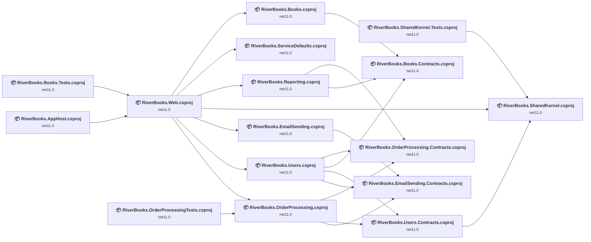

## Project Details

### RiverBooks.AppHost\RiverBooks.AppHost.csproj

#### Project Info

- **Current Target Framework:** net11.0✅
- **SDK-style**: True
- **Project Kind:** DotNetCoreApp
- **Dependencies**: 1
- **Dependants**: 0
- **Number of Files**: 1
- **Lines of Code**: 24
- **Estimated LOC to modify**: 0+ (at least 0,0% of the project)

#### Dependency Graph

Legend:
📦 SDK-style project
⚙️ Classic project

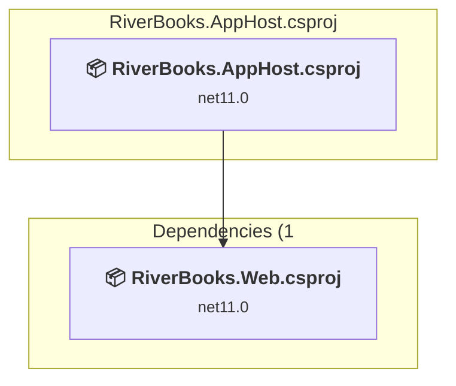

### API Compatibility

| Category | Count | Impact |
| :--- | :---: | :--- |
| 🔴 Binary Incompatible | 0 | High - Require code changes |
| 🟡 Source Incompatible | 0 | Medium - Needs re-compilation and potential conflicting API error fixing |
| 🔵 Behavioral change | 0 | Low - Behavioral changes that may require testing at runtime |
| ✅ Compatible | 0 |  |
| ***Total APIs Analyzed*** | ***0*** |  |

### RiverBooks.Books.Contracts\RiverBooks.Books.Contracts.csproj

#### Project Info

- **Current Target Framework:** net11.0✅
- **SDK-style**: True
- **Project Kind:** ClassLibrary
- **Dependencies**: 0
- **Dependants**: 3
- **Number of Files**: 2
- **Lines of Code**: 10
- **Estimated LOC to modify**: 0+ (at least 0,0% of the project)

#### Dependency Graph

Legend:
📦 SDK-style project
⚙️ Classic project

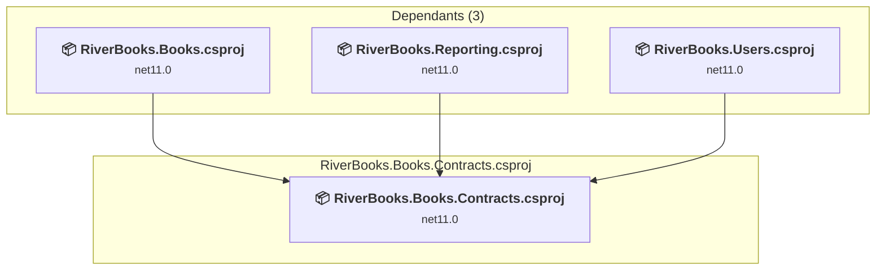

### API Compatibility

| Category | Count | Impact |
| :--- | :---: | :--- |
| 🔴 Binary Incompatible | 0 | High - Require code changes |
| 🟡 Source Incompatible | 0 | Medium - Needs re-compilation and potential conflicting API error fixing |
| 🔵 Behavioral change | 0 | Low - Behavioral changes that may require testing at runtime |
| ✅ Compatible | 0 |  |
| ***Total APIs Analyzed*** | ***0*** |  |

### RiverBooks.Books.Tests\RiverBooks.Books.Tests.csproj

#### Project Info

- **Current Target Framework:** net11.0✅
- **SDK-style**: True
- **Project Kind:** DotNetCoreApp
- **Dependencies**: 1
- **Dependants**: 0
- **Number of Files**: 6
- **Lines of Code**: 221
- **Estimated LOC to modify**: 0+ (at least 0,0% of the project)

#### Dependency Graph

Legend:
📦 SDK-style project
⚙️ Classic project

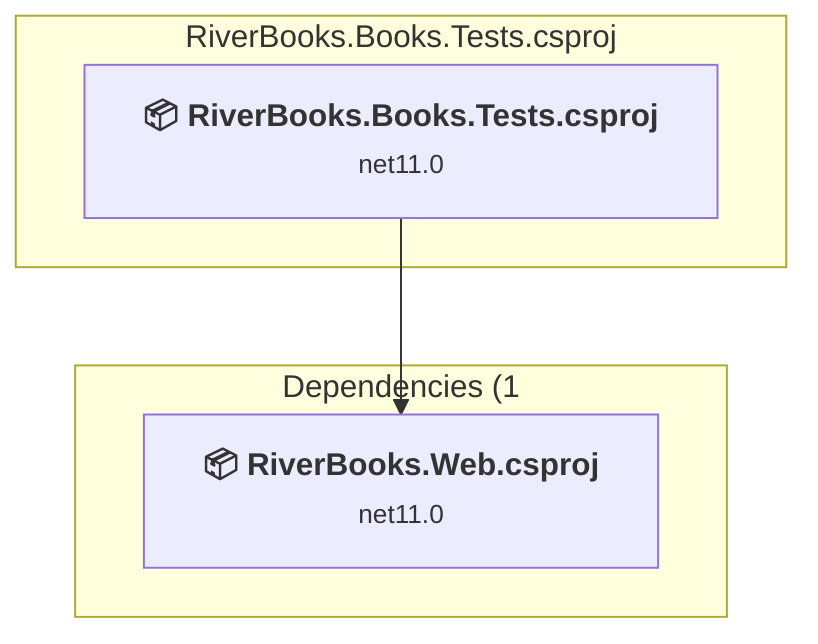

### API Compatibility

| Category | Count | Impact |
| :--- | :---: | :--- |
| 🔴 Binary Incompatible | 0 | High - Require code changes |
| 🟡 Source Incompatible | 0 | Medium - Needs re-compilation and potential conflicting API error fixing |
| 🔵 Behavioral change | 0 | Low - Behavioral changes that may require testing at runtime |
| ✅ Compatible | 0 |  |
| ***Total APIs Analyzed*** | ***0*** |  |

### RiverBooks.Books\RiverBooks.Books.csproj

#### Project Info

- **Current Target Framework:** net11.0✅
- **SDK-style**: True
- **Project Kind:** ClassLibrary
- **Dependencies**: 1
- **Dependants**: 1
- **Number of Files**: 28
- **Lines of Code**: 693
- **Estimated LOC to modify**: 0+ (at least 0,0% of the project)

#### Dependency Graph

Legend:
📦 SDK-style project
⚙️ Classic project

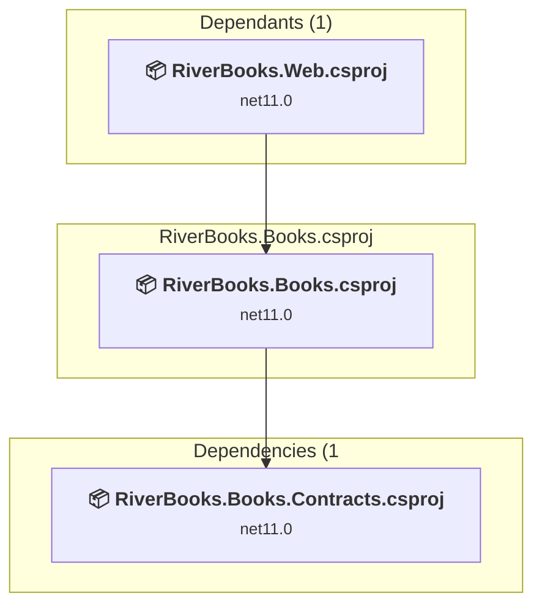

### API Compatibility

| Category | Count | Impact |
| :--- | :---: | :--- |
| 🔴 Binary Incompatible | 0 | High - Require code changes |
| 🟡 Source Incompatible | 0 | Medium - Needs re-compilation and potential conflicting API error fixing |
| 🔵 Behavioral change | 0 | Low - Behavioral changes that may require testing at runtime |
| ✅ Compatible | 0 |  |
| ***Total APIs Analyzed*** | ***0*** |  |

### RiverBooks.EmailSending.Contracts\RiverBooks.EmailSending.Contracts.csproj

#### Project Info

- **Current Target Framework:** net11.0✅
- **SDK-style**: True
- **Project Kind:** ClassLibrary
- **Dependencies**: 0
- **Dependants**: 3
- **Number of Files**: 1
- **Lines of Code**: 12
- **Estimated LOC to modify**: 0+ (at least 0,0% of the project)

#### Dependency Graph

Legend:
📦 SDK-style project
⚙️ Classic project

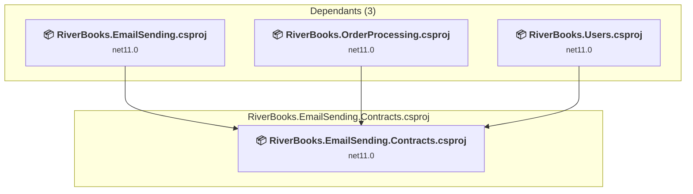

### API Compatibility

| Category | Count | Impact |
| :--- | :---: | :--- |
| 🔴 Binary Incompatible | 0 | High - Require code changes |
| 🟡 Source Incompatible | 0 | Medium - Needs re-compilation and potential conflicting API error fixing |
| 🔵 Behavioral change | 0 | Low - Behavioral changes that may require testing at runtime |
| ✅ Compatible | 0 |  |
| ***Total APIs Analyzed*** | ***0*** |  |

### RiverBooks.EmailSending\RiverBooks.EmailSending.csproj

#### Project Info

- **Current Target Framework:** net11.0✅
- **SDK-style**: True
- **Project Kind:** ClassLibrary
- **Dependencies**: 1
- **Dependants**: 1
- **Number of Files**: 13
- **Lines of Code**: 358
- **Estimated LOC to modify**: 0+ (at least 0,0% of the project)

#### Dependency Graph

Legend:
📦 SDK-style project
⚙️ Classic project

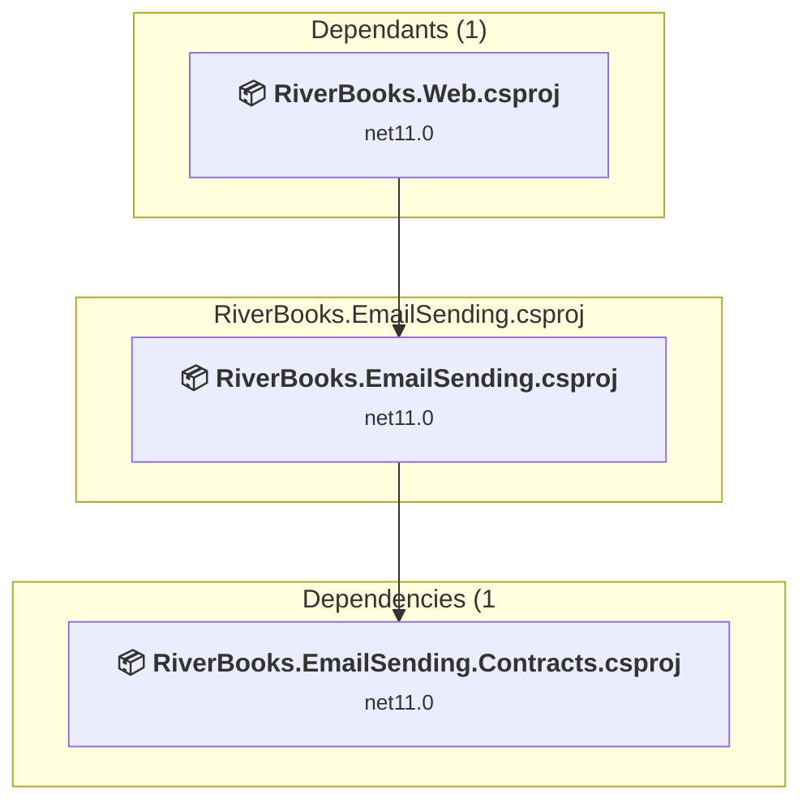

### API Compatibility

| Category | Count | Impact |
| :--- | :---: | :--- |
| 🔴 Binary Incompatible | 0 | High - Require code changes |
| 🟡 Source Incompatible | 0 | Medium - Needs re-compilation and potential conflicting API error fixing |
| 🔵 Behavioral change | 0 | Low - Behavioral changes that may require testing at runtime |
| ✅ Compatible | 0 |  |
| ***Total APIs Analyzed*** | ***0*** |  |

### RiverBooks.OrderProcessing.Contracts\RiverBooks.OrderProcessing.Contracts.csproj

#### Project Info

- **Current Target Framework:** net11.0✅
- **SDK-style**: True
- **Project Kind:** ClassLibrary
- **Dependencies**: 0
- **Dependants**: 3
- **Number of Files**: 5
- **Lines of Code**: 48
- **Estimated LOC to modify**: 0+ (at least 0,0% of the project)

#### Dependency Graph

Legend:
📦 SDK-style project
⚙️ Classic project

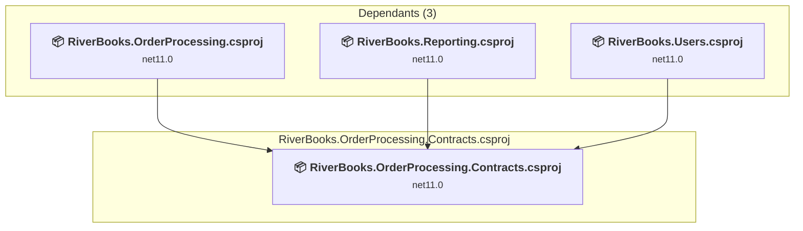

### API Compatibility

| Category | Count | Impact |
| :--- | :---: | :--- |
| 🔴 Binary Incompatible | 0 | High - Require code changes |
| 🟡 Source Incompatible | 0 | Medium - Needs re-compilation and potential conflicting API error fixing |
| 🔵 Behavioral change | 0 | Low - Behavioral changes that may require testing at runtime |
| ✅ Compatible | 0 |  |
| ***Total APIs Analyzed*** | ***0*** |  |

### RiverBooks.OrderProcessing\RiverBooks.OrderProcessing.csproj

#### Project Info

- **Current Target Framework:** net11.0✅
- **SDK-style**: True
- **Project Kind:** ClassLibrary
- **Dependencies**: 3
- **Dependants**: 2
- **Number of Files**: 39
- **Lines of Code**: 1443
- **Estimated LOC to modify**: 0+ (at least 0,0% of the project)

#### Dependency Graph

Legend:
📦 SDK-style project
⚙️ Classic project

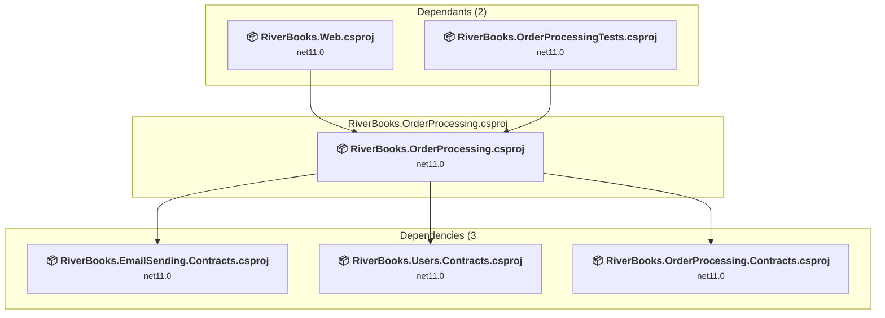

### API Compatibility

| Category | Count | Impact |
| :--- | :---: | :--- |
| 🔴 Binary Incompatible | 0 | High - Require code changes |
| 🟡 Source Incompatible | 0 | Medium - Needs re-compilation and potential conflicting API error fixing |
| 🔵 Behavioral change | 0 | Low - Behavioral changes that may require testing at runtime |
| ✅ Compatible | 0 |  |
| ***Total APIs Analyzed*** | ***0*** |  |

### RiverBooks.OrderProcessingTests\RiverBooks.OrderProcessingTests.csproj

#### Project Info

- **Current Target Framework:** net11.0✅
- **SDK-style**: True
- **Project Kind:** DotNetCoreApp
- **Dependencies**: 1
- **Dependants**: 0
- **Number of Files**: 8
- **Lines of Code**: 819
- **Estimated LOC to modify**: 0+ (at least 0,0% of the project)

#### Dependency Graph

Legend:
📦 SDK-style project
⚙️ Classic project

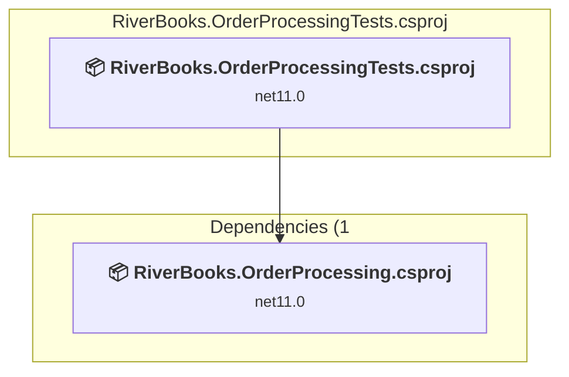

### API Compatibility

| Category | Count | Impact |
| :--- | :---: | :--- |
| 🔴 Binary Incompatible | 0 | High - Require code changes |
| 🟡 Source Incompatible | 0 | Medium - Needs re-compilation and potential conflicting API error fixing |
| 🔵 Behavioral change | 0 | Low - Behavioral changes that may require testing at runtime |
| ✅ Compatible | 0 |  |
| ***Total APIs Analyzed*** | ***0*** |  |

### RiverBooks.Reporting\RiverBooks.Reporting.csproj

#### Project Info

- **Current Target Framework:** net11.0✅
- **SDK-style**: True
- **Project Kind:** ClassLibrary
- **Dependencies**: 2
- **Dependants**: 1
- **Number of Files**: 14
- **Lines of Code**: 376
- **Estimated LOC to modify**: 0+ (at least 0,0% of the project)

#### Dependency Graph

Legend:
📦 SDK-style project
⚙️ Classic project

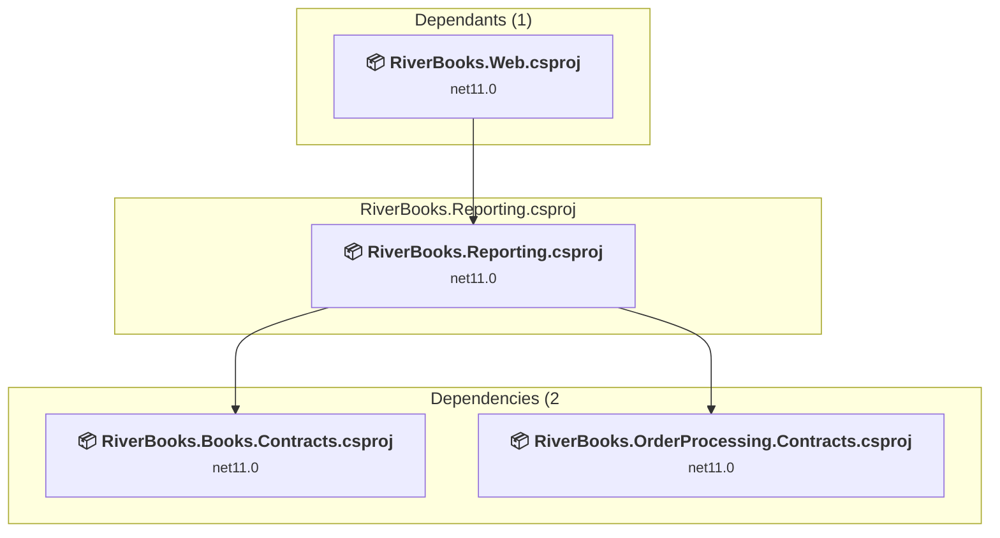

### API Compatibility

| Category | Count | Impact |
| :--- | :---: | :--- |
| 🔴 Binary Incompatible | 0 | High - Require code changes |
| 🟡 Source Incompatible | 0 | Medium - Needs re-compilation and potential conflicting API error fixing |
| 🔵 Behavioral change | 0 | Low - Behavioral changes that may require testing at runtime |
| ✅ Compatible | 0 |  |
| ***Total APIs Analyzed*** | ***0*** |  |

### RiverBooks.ServiceDefaults\RiverBooks.ServiceDefaults.csproj

#### Project Info

- **Current Target Framework:** net11.0✅
- **SDK-style**: True
- **Project Kind:** ClassLibrary
- **Dependencies**: 0
- **Dependants**: 1
- **Number of Files**: 1
- **Lines of Code**: 127
- **Estimated LOC to modify**: 0+ (at least 0,0% of the project)

#### Dependency Graph

Legend:
📦 SDK-style project
⚙️ Classic project

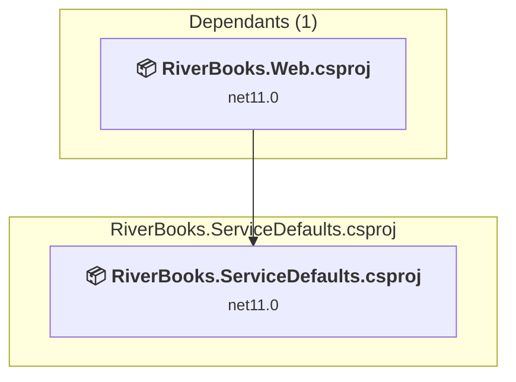

### API Compatibility

| Category | Count | Impact |
| :--- | :---: | :--- |
| 🔴 Binary Incompatible | 0 | High - Require code changes |
| 🟡 Source Incompatible | 0 | Medium - Needs re-compilation and potential conflicting API error fixing |
| 🔵 Behavioral change | 0 | Low - Behavioral changes that may require testing at runtime |
| ✅ Compatible | 0 |  |
| ***Total APIs Analyzed*** | ***0*** |  |

### RiverBooks.SharedKernel.Tests\RiverBooks.SharedKernel.Tests.csproj

#### Project Info

- **Current Target Framework:** net11.0✅
- **SDK-style**: True
- **Project Kind:** DotNetCoreApp
- **Dependencies**: 1
- **Dependants**: 0
- **Number of Files**: 3
- **Lines of Code**: 158
- **Estimated LOC to modify**: 0+ (at least 0,0% of the project)

#### Dependency Graph

Legend:
📦 SDK-style project
⚙️ Classic project

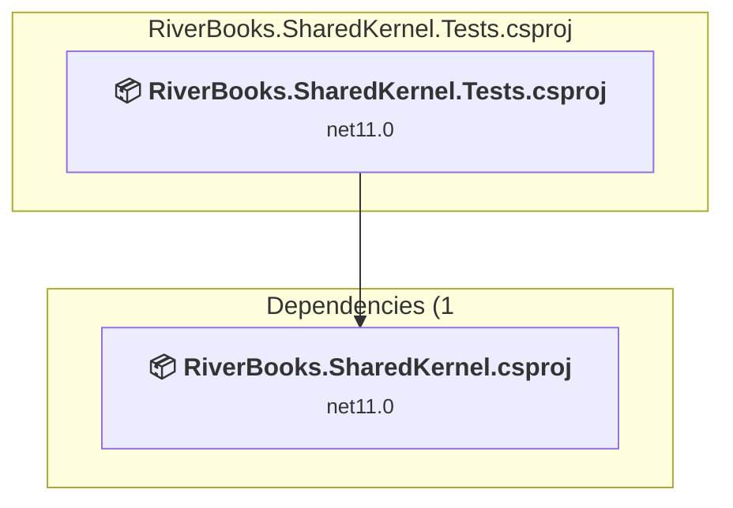

### API Compatibility

| Category | Count | Impact |
| :--- | :---: | :--- |
| 🔴 Binary Incompatible | 0 | High - Require code changes |
| 🟡 Source Incompatible | 0 | Medium - Needs re-compilation and potential conflicting API error fixing |
| 🔵 Behavioral change | 0 | Low - Behavioral changes that may require testing at runtime |
| ✅ Compatible | 0 |  |
| ***Total APIs Analyzed*** | ***0*** |  |

### RiverBooks.SharedKernel\RiverBooks.SharedKernel.csproj

#### Project Info

- **Current Target Framework:** net11.0✅
- **SDK-style**: True
- **Project Kind:** ClassLibrary
- **Dependencies**: 0
- **Dependants**: 3
- **Number of Files**: 9
- **Lines of Code**: 320
- **Estimated LOC to modify**: 0+ (at least 0,0% of the project)

#### Dependency Graph

Legend:
📦 SDK-style project
⚙️ Classic project

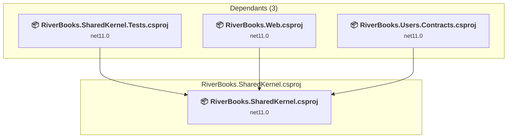

### API Compatibility

| Category | Count | Impact |
| :--- | :---: | :--- |
| 🔴 Binary Incompatible | 0 | High - Require code changes |
| 🟡 Source Incompatible | 0 | Medium - Needs re-compilation and potential conflicting API error fixing |
| 🔵 Behavioral change | 0 | Low - Behavioral changes that may require testing at runtime |
| ✅ Compatible | 0 |  |
| ***Total APIs Analyzed*** | ***0*** |  |

### RiverBooks.Users.Contracts\RiverBooks.Users.Contracts.csproj

#### Project Info

- **Current Target Framework:** net11.0✅
- **SDK-style**: True
- **Project Kind:** ClassLibrary
- **Dependencies**: 1
- **Dependants**: 2
- **Number of Files**: 6
- **Lines of Code**: 45
- **Estimated LOC to modify**: 0+ (at least 0,0% of the project)

#### Dependency Graph

Legend:
📦 SDK-style project
⚙️ Classic project

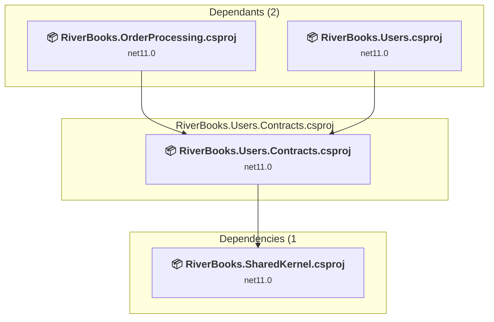

### API Compatibility

| Category | Count | Impact |
| :--- | :---: | :--- |
| 🔴 Binary Incompatible | 0 | High - Require code changes |
| 🟡 Source Incompatible | 0 | Medium - Needs re-compilation and potential conflicting API error fixing |
| 🔵 Behavioral change | 0 | Low - Behavioral changes that may require testing at runtime |
| ✅ Compatible | 0 |  |
| ***Total APIs Analyzed*** | ***0*** |  |

### RiverBooks.Users\RiverBooks.Users.csproj

#### Project Info

- **Current Target Framework:** net11.0✅
- **SDK-style**: True
- **Project Kind:** ClassLibrary
- **Dependencies**: 4
- **Dependants**: 1
- **Number of Files**: 63
- **Lines of Code**: 3189
- **Estimated LOC to modify**: 0+ (at least 0,0% of the project)

#### Dependency Graph

Legend:
📦 SDK-style project
⚙️ Classic project

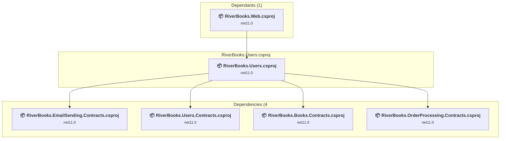

### API Compatibility

| Category | Count | Impact |
| :--- | :---: | :--- |
| 🔴 Binary Incompatible | 0 | High - Require code changes |
| 🟡 Source Incompatible | 0 | Medium - Needs re-compilation and potential conflicting API error fixing |
| 🔵 Behavioral change | 0 | Low - Behavioral changes that may require testing at runtime |
| ✅ Compatible | 0 |  |
| ***Total APIs Analyzed*** | ***0*** |  |

### RiverBooks.Web\RiverBooks.Web.csproj

#### Project Info

- **Current Target Framework:** net11.0✅
- **SDK-style**: True
- **Project Kind:** AspNetCore
- **Dependencies**: 7
- **Dependants**: 2
- **Number of Files**: 6
- **Lines of Code**: 104
- **Estimated LOC to modify**: 0+ (at least 0,0% of the project)

#### Dependency Graph

Legend:
📦 SDK-style project
⚙️ Classic project

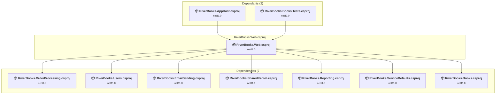

### API Compatibility

| Category | Count | Impact |
| :--- | :---: | :--- |
| 🔴 Binary Incompatible | 0 | High - Require code changes |
| 🟡 Source Incompatible | 0 | Medium - Needs re-compilation and potential conflicting API error fixing |
| 🔵 Behavioral change | 0 | Low - Behavioral changes that may require testing at runtime |
| ✅ Compatible | 0 |  |
| ***Total APIs Analyzed*** | ***0*** |  |

